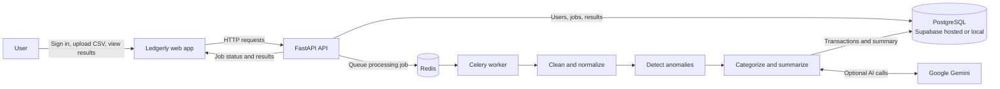

# Ledgerly

### AI-powered transaction intelligence

Ledgerly turns raw transaction CSVs into clear, account-specific insights. Upload a file to clean and categorize transactions, spot unusual activity, and explore a concise spending summary.

## Why Ledgerly

Financial exports are often inconsistent: dates and amounts vary in format, categories may be missing, and suspicious activity can be hard to notice in a spreadsheet. Ledgerly automates the first pass so people can focus on the transactions that need attention.

## Product features

- **Private workspaces:** create an account and see only the analyses you uploaded.
- **CSV analysis:** upload a transaction file and follow its processing status.
- **Data cleanup:** normalize common date, amount, currency, and status variations; remove duplicate rows.
- **Anomaly detection:** flag outliers and merchant/currency mismatches with an explanation.
- **AI categorization:** classify uncategorized transactions and generate a readable summary with Gemini.
- **Results dashboard:** review spending totals, category breakdowns, merchants, and flagged transactions.
- **Sample data:** try the included transaction CSV from the app.

## System architecture

The API handles accounts, uploads, and results. It puts processing work onto Redis so CSV analysis can run asynchronously in the Celery worker. The worker stores cleaned transactions and summaries in PostgreSQL. Gemini adds categories and narrative analysis when configured; computed totals and anomaly detection remain part of the processing pipeline.

## Processing pipeline

1. Validate the uploaded CSV columns and create a job for the signed-in account.
2. Normalize transaction fields and remove exact duplicate rows.
3. Detect unusual amounts and known merchant/currency mismatches.
4. Use Gemini to categorize uncategorized transactions and write a summary when available.
5. Save cleaned transactions, anomaly details, and summary data for the dashboard.

## Technology

| Layer | Tools |
|---|---|
| Web app | HTML, CSS, JavaScript, Nginx |
| API and authentication | FastAPI, Pydantic, JWT, Argon2 |
| Data storage | PostgreSQL, SQLAlchemy |
| Background processing | Celery, Redis |
| AI analysis | Google Gemini |
| Development environment | Docker Compose |

## API surface

| Endpoint | Purpose |
|---|---|
| `POST /auth/signup` | Create an account |
| `POST /auth/login` | Sign in and receive a bearer token |
| `GET /auth/me` | Return the signed-in account |
| `POST /jobs/upload` | Upload a CSV for analysis |
| `GET /jobs` | List the signed-in account’s analyses |
| `GET /jobs/{job_id}/status` | Check processing progress and summary |
| `GET /jobs/{job_id}/results` | Get cleaned transactions and anomalies |
| `GET /health` | Check API availability |

## Security and data ownership

Passwords are stored as Argon2 hashes. API access uses signed bearer tokens, and every analysis endpoint scopes jobs to the authenticated account. Database credentials and AI keys belong in server-side environment variables; they should never be committed to the repository or embedded in frontend code.

## Example dataset

[`transactions.csv`](transactions.csv) contains sample transactions with mixed date and amount formats, missing categories, duplicate rows, and seeded outliers. It is intended for demonstrating the cleanup and anomaly-detection flow.
